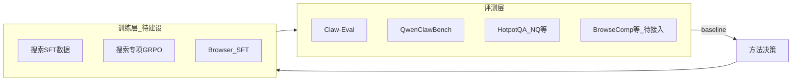

# 00 — 项目概览

## 1. 项目目标

提升 **Qwen/OpenClaw agent** 在真实任务中的**多轮搜索能力**，使其能够：

- 在需要外部信息时**主动、合理地调用搜索工具**（而非幻觉或单次猜测）
- 在 workspace 已有知识时**优先 memory/KB 检索**，必要时再 web 搜索
- 通过**浏览器**深入阅读网页内容，完成复杂信息获取与验证

搜索能力是 **agent 能力**的子集：与工具调用格式、多轮规划、reward 设计、评测闭环强相关。

## 2. 成功标准（草案，需人工确认）

| 指标 | 说明 | 待定项 |
|------|------|--------|
| L2 Agent 主指标 | Claw-Eval 搜索子集 + QCB Research/Memory 域 | Pass@1 还是 Pass^3 |
| L1 QA 辅助指标 | HotpotQA/NQ subset EM | 是否作为 gate |
| 相对提升 | 相对 baseline checkpoint | 目标 +X%（人定） |
| 安全不回归 | T073 等注入/安全任务 | 通过率不降 |
| 效率 | 平均搜索轮数、API 调用成本 | 上限阈值 |

## 3. 现状诊断

仓库 `/dev/gpc_code` 是 OpenClaw/Qwen agent 的**训练与评测工厂**（GPC 为模型存储路径约定，如 `/data/gpc/models`）。

### 3.1 评测有、训练无

| 维度 | 现状 | 关键路径 |
|------|------|----------|
| 网页搜索评测 | Claw-Eval 约 93 任务与 web 相关；QCB 7 个 Research 任务 | `claw_eval_new/claw-eval/` |
| 知识库检索评测 | Claw-Eval T016/T015 kb_search；QCB 约 16 个 memory/KB 任务 | 同上 + QCB tasks |
| RL 训练 | **禁用** `web_search` / `memory_search` | `clawGym/ClawGym-Agents/RL/clawgym_rl_rollout.py` |
| 训练数据 | ClawGym 2000 任务**排除 web 工具** | `clawGym/ClawGym-Agents/RL/data/DATASET_README.md` |
| Search-R1 参考 | slime QA 检索 RL，**未接入 OpenClaw** | `slime_0427/slime/examples/search-r1/` |
| 浏览器 | OpenClaw-RL gui-rl；QCB 约 3 个 browser 相关任务 | `OpenClaw-RL/gui-rl/` |

### 3.2 核心矛盾

模型在 **SFT** 阶段见过 `web_fetch` / `memory_read` 等 schema，但在 **RL** 阶段 gateway 配置为：

```json
"tools": {
  "profile": "coding",
  "deny": ["web_search", "memory_search"]
}
```

同时训练集明确排除 web 相关任务 → **搜索策略无法通过 RL 信号强化**，与评测侧能力要求脱节。

### 3.3 架构关系（目标态）



## 4. 项目范围

### In scope

- 调研：开源项目、论文、业界 benchmark 与训练范式
- Benchmark：分层评测体系 + baseline
- 方法选型：SFT / RL / DPO 等路线对比与冒烟
- 数据：搜索多轮轨迹的合成、获取与质检
- 训练：OpenClaw 工具栈下的搜索专项训练
- 评估：标准集 + 真实使用场景

### Out of scope（v1）

- 通用 agent 全能力重写（仅聚焦搜索相关工具链）
- WebArena 全量接入（列为 L3 / v2）
- 新检索模型训练（使用现有 Brave/SERP/本地 retriever）

## 5. 六阶段总览

| 阶段 | 名称 | 与并行关系 |
|------|------|------------|
| 1 | 信息收集与调研 | — |
| 2 | Benchmark 与 Baseline | 与 4 部分并行 |
| 3 | 方法决策与冒烟测试 | 依赖 1、2 |
| 4 | 数据准备与质量核验 | 与 2 并行 |
| 5 | 环境构建与训练 | 依赖 3、4 |
| 6 | 效果评估与迭代 | 依赖 5 |

总周期约 **10–12 周**（含并行）。

## 6. 首期执行顺序（计划确认后执行）

1. 完成阶段 1 Landscape Report 并人工评审  
2. 从 Claw-Eval / QCB 导出搜索 task 清单，设计 `search_eval/` 结构  
3. 跑 baseline（需人：选定 checkpoint、API key）  
4. 冒烟测试各训练路线 POC  
5. 全量数据与训练  

详见各 `phases/` 文档。
