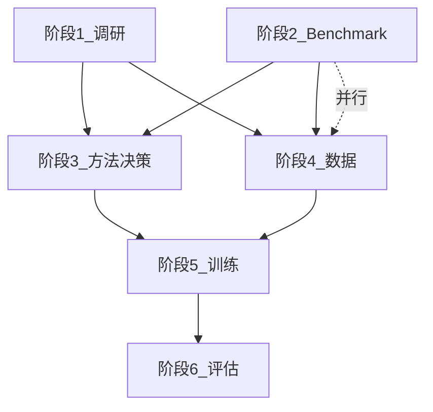

# 02 — 里程碑与时间线

## 总周期

约 **10–12 周**（阶段 2 与 4 并行，可压缩日历时间）。

## 里程碑

| ID | 名称 | 目标周 | 关键产出 | 门禁（人签） |
|----|------|--------|----------|--------------|
| M1 | 调研完成 | W2 | Landscape Report | 调研范围与 shortlist 确认 |
| M2 | Baseline 就绪 | W3 | Benchmark v0.1 + baseline 分数 | 主指标与 baseline 模型确认 |
| M3 | 方法确定 | W4–5 | 决策 memo + 冒烟结果 | 训练路线与预算批准 |
| M4 | 数据 v1 | W5–7 | SFT/RL 数据集 | 抽检通过与配比确认 |
| M5 | 训练 v1 | W8–10 | 候选 checkpoint | 选优 checkpoint |
| M6 | 评估完成 | W11–12 | 评估报告 | 发布 sign-off |

## 依赖关系

## 阶段日历（建议）

| 周 | 阶段 1 | 阶段 2 | 阶段 3 | 阶段 4 | 阶段 5 | 阶段 6 |
|----|--------|--------|--------|--------|--------|--------|
| W1 | 调研 A/B/C | task 清单 | | | | |
| W2 | 调研 D/E + report | runner 设计 | | 数据方案 | | |
| W3 | | **baseline 跑通** | | schema 定义 | | |
| W4 | | | 冒烟 A/B | rollout 启动 | | |
| W5 | | | **路线决策** | 数据 v1 主量 | | |
| W6 | | | | 质检 | | |
| W7 | | | | **数据 sign-off** | 环境改造 | |
| W8 | | eval subset | | | SFT/RL run | |
| W9 | | | | | 训练监控 | |
| W10 | | | | | **checkpoint 候选** | |
| W11 | | 全量 eval | | | | 报告 |
| W12 | | | | | | **sign-off** |

## 各阶段交付物路径（规划）

| 交付物 | 路径 |
|--------|------|
| Landscape Report | `docs/agent_search/reports/search_landscape_report.md` |
| Benchmark 配置 | `search_eval/configs/benchmark_suite.yaml` |
| Task 清单 | `search_eval/configs/task_lists/` |
| Baseline 结果 | `search_eval/baselines/` |
| 方法决策 memo | `docs/agent_search/reports/method_decision_memo.md` |
| 冒烟结果 | `docs/agent_search/reports/smoke_test_results.md` |
| SFT 数据 | `data/search_sft_v1/` |
| RL 数据 | `data/search_rl_v1/` |
| 训练配置 | `search_train/configs/`（规划） |
| 评估报告 | `docs/agent_search/reports/search_capability_evaluation_report.md` |

## 当前进度

| 里程碑 | 状态 | 备注 |
|--------|------|------|
| M0 计划文档落地 | **进行中** | `docs/agent_search/` |
| M1 | 未开始 | |
| M2 | 未开始 | |
| M3 | 未开始 | |
| M4 | 未开始 | |
| M5 | 未开始 | |
| M6 | 未开始 | |

> 进度请在各 phase 文档末尾「状态」节更新，或在 PR/会议中同步。
