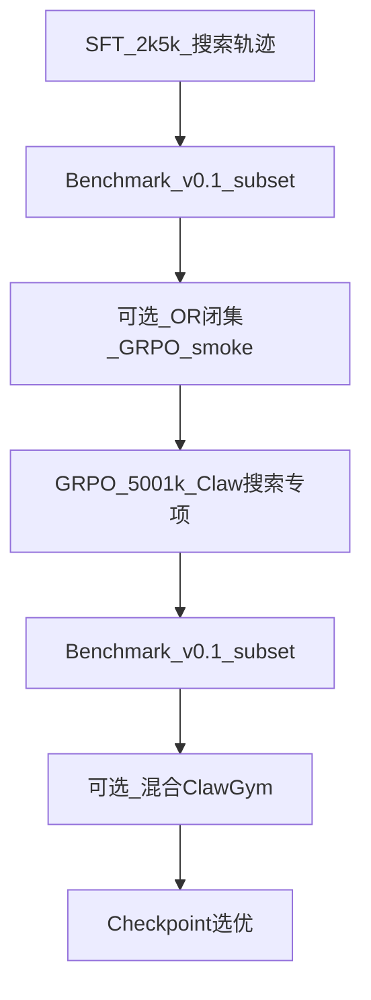

# 阶段 5 — 环境构建与训练

**周期**：~3–4 周  
**依赖**：阶段 3 路线确定、阶段 4 数据 v1  
**目标**：搜索专项训练环境 + 主训练 run + 监控迭代。

**环境构建专篇**：[reports/openresearcher_env_setup.md](../reports/openresearcher_env_setup.md)（含数据、检索服务、训练接入、Claw 适配 checklist）

---

## 1. 环境改造清单

| 组件 | 改动 | 文件 / 参考 |
|------|------|-------------|
| **OpenResearcher 闭集检索** | Corpus+index 下载；`start_search_service.sh`；**改 corpus 路径**（非默认 BCP） | [openresearcher_env_setup.md](../reports/openresearcher_env_setup.md) §2–3 |
| RL rollout | 启用 web_search/memory_search；`search` profile | `clawgym_rl_rollout.py` |
| 工具沙箱 | mock SERP + 搜索缓存；`web_fetch` maxChars 可配 | `clawgym_tools.py` |
| slime 搜索 RL | Qwen3.5 chat template；OpenResearcher Q+A parquet | 基于 `generate_with_search.py` 新建 |
| SFT | 搜索数据 tokenization；可选 OR `messages` | ClawGym SFT pipeline |
| Browser | 浏览器工具 | OpenClaw-RL / Claw-Eval mock |
| 部署 | SGLang | `sglang_deploy_3_5.sh` |

### 1.1 双池架构（建议）

| 池 | 环境 | 数据 | 目的 |
|----|------|------|------|
| **闭集 smoke** | OpenResearcher local dense | Dataset Q+A | GRPO 链路验证；对齐 TRACE 族 |
| **Claw 主池** | web_search + web_fetch（mock 或 API） | Claw-Eval / 自 rollout | 生产 schema；阶段 6 主评测 |

工具映射：`search`→`web_search`，`open`→`web_fetch`；**不设 `find`**（长页策略待 `web_fetch_length_survey.md` 实测）。

### 1.2 search profile 设计（草案）

与现有 `coding` profile 并存：

- `OPENCLAW_TOOLS_PROFILE=search`
- `deny: []` 或仅 deny 无关工具
- 启用 `web_search`, `memory_search`, `web_fetch`

---

## 2. OpenResearcher 环境 smoke（阶段 5 前置）

按 [openresearcher_env_setup.md](../reports/openresearcher_env_setup.md) §7 Phase 4–5 checklist：

```bash
# 1. 检索服务（dense，port 8000）
bash scripts/start_search_service.sh dense 8000

# 2. 验证 search API
curl -s -X POST http://127.0.0.1:8000/search \
  -H 'Content-Type: application/json' \
  -d '{"query": "...", "topn": 3}'

# 3. slime GRPO：OpenResearcher Q+A parquet + rollout（max_turns smoke 10–20）
# 4. ClawGym：search profile + Claw-Eval 子集 GRPO
```

**注意**：默认 `start_search_service.sh` 绑 **BrowseComp-Plus** 语料；训练用 **OpenResearcher-Corpus** 须改 `CORPUS_PARQUET_PATH` / `DENSE_INDEX_PATH`（专篇 §3.2）。

---

## 3. 训练 Schedule（路线 A 示例）



**GRPO baseline**：纯 outcome EM；turn credit（MA-TRACE）在 baseline 跑通后再叠。

---

## 4. 监控指标

| 类别 | 指标 |
|------|------|
| 训练 | loss, reward 均值/方差, tool 分布, 搜索轮数, KL |
| 评测 | 每 N step 跑 L1 + L2 子集 |
| 异常 | API 失败率, 超时率, reward hacking |
| 环境 | 检索 latency, fetch 截断率（`truncated: true`） |

---

## 5. 目录规划

```
search_train/
  configs/
    search_sft.yaml
    search_grpo.yaml
    openresearcher_smoke_grpo.yaml
  scripts/
    run_search_sft.sh
    run_search_grpo.sh
    run_or_local_search.sh      # 起检索 sidecar
  logs/
checkpoints/
  search_v1/
/data/openresearcher/           # corpus / index / dataset（规划）
```

---

## 6. 人机分工

| Agent | 人 |
|-------|-----|
| 配置与脚本；OpenResearcher clone；检索 smoke；提交 job | 超参；Corpus 存储/GPU；checkpoint 选优；混合比例；reward 修正 |

---

## 7. 交付物

- [ ] OpenResearcher 检索 smoke 通过  
- [ ] 2–3 个候选 checkpoint  
- [ ] `reports/training_run_comparison.md`  
- [ ] `reports/openresearcher_env_setup.md` ✅（指南）  
- [ ] decision_log：D7  

---

## 8. 完成标准

- [ ] 至少一次完整 SFT 或 RL run 无 infra 阻断  
- [ ] 闭集 **或** Claw 开网/mock **至少一条** GRPO smoke 完成  
- [ ] L2 子集相对 baseline 有 measurable 变化（方向不限，供阶段 6 判断）  

---

## 9. 状态

| 项 | 状态 |
|----|------|
| 改造方案 | ✅ 文档（含 OpenResearcher 专篇） |
| OpenResearcher 检索 deploy | ⬜ |
| search profile 代码 | ⬜ |
| 训练 run | ⬜ |
