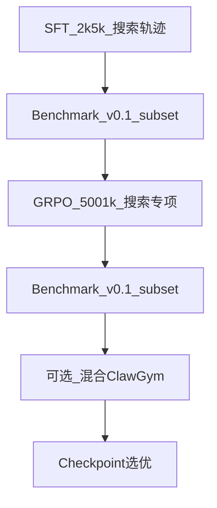

# 阶段 5 — 环境构建与训练

**周期**：~3–4 周  
**依赖**：阶段 3 路线确定、阶段 4 数据 v1  
**目标**：搜索专项训练环境 + 主训练 run + 监控迭代。

---

## 1. 环境改造清单

| 组件 | 改动 | 文件 |
|------|------|------|
| RL rollout | 启用 web_search/memory_search；`search` profile | `clawgym_rl_rollout.py` |
| 工具沙箱 | mock SERP + 搜索缓存 | `clawgym_tools.py` |
| slime 搜索 RL | Qwen3.5 chat template | 基于 `generate_with_search.py` 新建 |
| SFT | 搜索数据 tokenization | ClawGym SFT pipeline |
| Browser | 浏览器工具 | OpenClaw-RL / Claw-Eval mock |
| 部署 | SGLang | `sglang_deploy_3_5.sh` |

### search profile 设计（草案）

与现有 `coding` profile 并存，通过环境变量切换，例如：

- `OPENCLAW_TOOLS_PROFILE=search`
- `deny: []` 或仅 deny 无关工具
- 启用 `web_search`, `memory_search`, `web_fetch`

---

## 2. 训练 Schedule（路线 A 示例）



---

## 3. 监控指标

| 类别 | 指标 |
|------|------|
| 训练 | loss, reward 均值/方差, tool 分布, 搜索轮数, KL |
| 评测 | 每 N step 跑 L1 + L2 子集 |
| 异常 | API 失败率, 超时率, reward hacking |

---

## 4. 目录规划

```
search_train/
  configs/
    search_sft.yaml
    search_grpo.yaml
  scripts/
    run_search_sft.sh
    run_search_grpo.sh
  logs/
checkpoints/
  search_v1/
```

---

## 5. 人机分工

| Agent | 人 |
|-------|-----|
| 配置与脚本；提交 job；日志与 eval 触发 | 超参；算力；checkpoint 选优；混合比例；reward 修正 |

---

## 6. 交付物

- [ ] 2–3 个候选 checkpoint  
- [ ] `reports/training_run_comparison.md`  
- [ ] decision_log：D7  

---

## 7. 完成标准

- [ ] 至少一次完整 SFT 或 RL run 无 infra 阻断  
- [ ] L2 子集相对 baseline 有 measurable 变化（方向不限，供阶段 6 判断）  

---

## 8. 状态

| 项 | 状态 |
|----|------|
| 改造方案 | ✅ 文档 |
| search profile 代码 | ⬜ |
| 训练 run | ⬜ |
