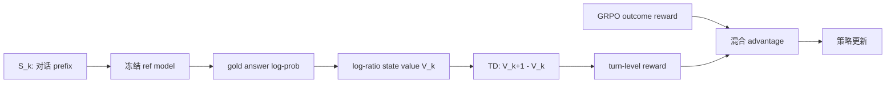
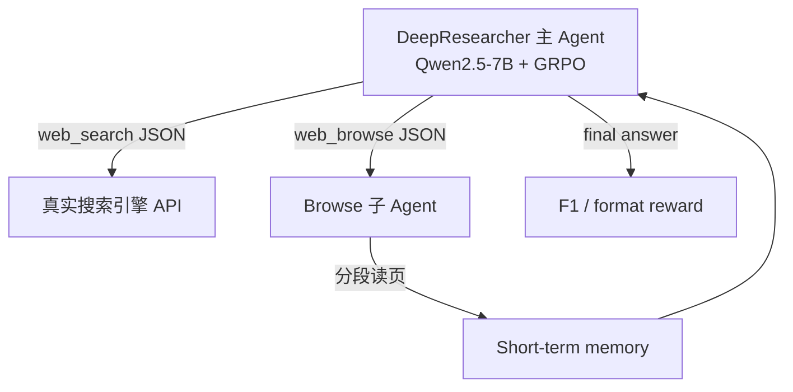

# Agent Search 五篇代表论文深度解读

> Agent Search 能力提升项目 · 增量调研  
> 版本：v0.1 | 日期：2026-08-27 | 覆盖：LiveBrowseComp、TRACE、ABSeeker、Tree-GRPO、DeepResearcher

---

## 0. 为什么选这五篇

| 论文 | arXiv | 角色 |
|------|-------|------|
| [LiveBrowseComp](https://arxiv.org/abs/2605.28721) | 2605.28721 | **评测**：戳穿静态 benchmark 的「伪搜索」 |
| [TRACE](https://arxiv.org/html/2607.13988) | 2607.13988 | **训练**：无 critic、无 SFT 冷启动的 turn-level RL credit |
| [ABSeeker](https://arxiv.org/html/2608.05102) | 2608.05102 | **训练**：用 GT 反推 clue，做逐步 SFT/GRPO |
| [Tree-GRPO](https://arxiv.org/abs/2509.21240) | 2509.21240 | **训练**：树状 rollout，省 token/API 预算 |
| [DeepResearcher](https://arxiv.org/abs/2504.03160) | 2504.03160 | **系统**：真实 web + browse 子 agent + GRPO |

五篇合起来覆盖 **「怎么评 → 怎么训 → 用什么环境」**，且都是 2025–2026 年 agent search 主线工作。

---

## 1. LiveBrowseComp — 静态 BrowseComp 在测什么？

**论文**：*LiveBrowseComp: Are Search Agents Searching, or Just Verifying What They Already Know?*（HIT + 小红书，2026）

### 1.1 要解决的问题

BrowseComp 等静态 deep-search benchmark 分数很高，但不确定 agent 是 **真在发现信息**，还是 **靠 parametric 知识猜答案再用搜索确认**（Intrinsic Knowledge Dependence, IKD）。

### 1.2 做了什么

**阶段 A：诊断实验（BrowseComp / BrowseComp-ZH / HLE / GAIA）**

三组对照：

1. **Closed-book**：关掉所有工具，纯 parametric 答题 → 测「不看 web 能答多少」
2. **Evidence-blocked search**（BrowseComp-Plus）：检索索引里去掉 gold/evidence 文档，只留 irrelevant/hard-negative → 测「搜不到支持证据时搜索是否还有用」
3. **Trajectory grounding**：统计 query 是「模型自己 hypothesize 出来的」还是「从检索结果延伸出来的」；检索到支持证据后是否真正用上

**阶段 B：新 benchmark LiveBrowseComp**

- **335 题**，人工撰写，8 类主题
- 每题至少依赖 **过去 90 天内发布** 的事实；种子来自 GDELT、TMDB、RAWG、CVE/NVD、SportsDB、USGS
- **长尾过滤**：排除全球热点，保留 obscure 但可验证的事实
- **答案稳定**：90 天内不会变（排除票房累计等动态指标）
- 多轮人工验证：正确性/唯一性、30 分钟内可解难度、时间依赖性

### 1.3 核心发现（诊断）

| 现象 | 数据要点 |
|------|----------|
| 无工具也能答很多 | closed-book pass@4 平均 **38.9%**；MiniMax M2.5 在 BrowseComp **44.5%** |
| 搜不到证据反而更差 | evidence-blocked 平均 **6.2%**，**低于** closed-book **26.1%** |
| 搜索由模型主导 | **>50%** query 来自模型自身 hypothesis，后期 >60% |
| 证据利用率低 | 检索到支持证据后，使用率 **<33%** |

→ 静态 benchmark 高分可能混入了 **「会猜 + 会验证」**，不等于 **「会发现未知信息」**。

### 1.4 LiveBrowseComp 评测结果

- 工具：Serper + Jina visit + code sandbox；250 step / 256k context
- **Closed-book 全员 <2%** → 时间约束有效压制 IKD
- 相对 BrowseComp，search-augmented 分数 **降 25–40 pt**（例：GLM 5.1 68.0→33.9）
- **排名洗牌**：BrowseComp 榜首模型在 LiveBrowseComp 不一定领先
- **人类难度相当**：BrowseComp 30% vs LiveBrowseComp 31% 可解率

### 1.5 对 GPC 的启示

- 支持你们对 **「BrowseComp 上 AI4AI/SFT 刷榜」** 的质疑：静态题 + GT 筛选轨迹，容易奖励 **记忆验证** 而非 **证据驱动搜索**
- 阶段 2 评测应 **train/eval 分离**，并考虑 **时间敏感 / Claw-Eval 真实任务** 作为补充
- 若用 BrowseComp 做 RL reward，需意识到 reward 与「真搜索能力」可能不对齐

---

## 2. TRACE — 不用 process label 的逐步 RL credit

**论文**：*TRACE: Turn-level Reward Assignment via Credit Estimation for Long-Horizon Agents*（2026-07）

### 2.1 要解决的问题

多轮 agent（几十上百次 tool call）只有 **轨迹级 outcome reward** 时：

- 失败轨迹里可能有有用步骤，却被整体负 advantage 惩罚
- 成功轨迹里可能有冗余/错误步骤，却被整体正 advantage 奖励
- credit 稀疏、方差大，长程搜索难训

### 2.2 方法概要

**核心思想**：用 **冻结的 reference model**（训练初始 checkpoint）探测「当前 prefix 下 gold answer 有多可预测」，在 **tool-call 边界** 做 TD credit。

**步骤**：

1. 在每次 tool call 后切 state \(S_k\)
2. 用 ref model 算 prefix 上 gold answer 的平均 log-prob → 转成 **log-ratio value** \(V_k\)
3. **Turn reward** = 相邻 value 的 TD 差（telescoping，冗余中间步不会累积虚高 credit）
4. 与 GRPO 的 **outcome advantage** 混合（\(\alpha_{\mathrm{out}}=1.0, \alpha_{\mathrm{turn}}=0.2\)）

**训练设定（刻意极简）**：

- **无 SFT 冷启动**、无 agentic mid-training、无 live-web 训练数据
- 数据：OpenResearcher offline corpus 上 **合成多文档链式检索题**（比 HotpotQA 更长程）
- Harness：`browser.search` / `browser.open` / `browser.find` + FAISS 检索
- 模型：Qwen3-4B-Thinking、Qwen3-30B-A3B-Thinking
- 每 prompt 8 rollouts，最多 60 tool turns

### 2.3 效果

**Table：四 benchmark 平均（TRACE vs 控制变量 RL）**

| 模型 | 方法 | BrowseComp-Plus | BrowseComp | GAIA | xbench-DeepSearch | Avg |
|------|------|-----------------|------------|------|-------------------|-----|
| Qwen3-4B | Base | 7.2 | 3.3 | 24.2 | 19.0 | 13.4 |
| Qwen3-4B | GRPO | 30.0 | 5.1 | 38.8 | 44.0 | 29.5 |
| Qwen3-4B | **TRACE** | **35.6** | **6.7** | **44.6** | **49.0** | **34.0** |
| Qwen3-30B-A3B | Base | 8.4 | 4.4 | 34.1 | 20.0 | 16.7 |
| Qwen3-30B-A3B | GRPO | 36.4 | 10.8 | 45.6 | 37.0 | 32.5 |
| Qwen3-30B-A3B | **TRACE** | **42.6** | **12.9** | **52.0** | **45.0** | **38.1** |

要点：

- 4B TRACE **超过** 多个更大 deep-research agent 在 BrowseComp-Plus 上的参考分数
- **闭集训练 → 开网 Serper 评测** 仍有效（跨 corpus / 语言）
- 学习曲线：**更早上升、更高 plateau**；平均 tool 轮数增长更快

### 2.4 局限

- 价值估计依赖 **短答案 gold string** 的 log-prob；长报告、开放任务不适用
- 训练在 **closed corpus**，与 OpenClaw 真实 Brave/SERP + KB 仍有 gap

### 2.5 对 GPC 的启示

- **ClawGym search profile GRPO** 可借鉴：outcome reward + turn-level TD（不必另训 PRM）
- ref model 可用 **训练初 checkpoint**，实现成本低
- 与 ABSeeker 对比：TRACE **不需要 GT 反推 clue**，但 credit 是 implicit 的；ABSeeker 是 explicit rubric

---

## 3. ABSeeker — 从答案反推 clue，逐步加权 SFT + GRPO

**论文**：*ABSeeker: Training Long-Horizon Search Agents via Answer-Backtracked Credit Assignment*（上海交大等，2026-08）

### 3.1 要解决的问题

与 TRACE 同类：**长程 search 轨迹里好坏步骤混在一起**，轨迹级 SFT/RL 无法区分。

### 3.2 方法：ABC（Answer-Backtracked Credit Assignment）

**Stage 1 — Answer-Backtracked Clue Recovery**

- 输入：query + **verified answer**（训练集 GT）
- 用强 LLM（DeepSeek-V4-Flash）做 **ReAct 反查**：从答案往回 web search，恢复中间 clue 集合 \(\mathcal{C}\)（实体、关系、约束）

**Stage 2 — Clue-Anchored Step Scoring**

- 对轨迹每一步，按 rubric 打分（base 1.0，clip 到 [0, 2.0]）：

| 行为 | Δ |
|------|---|
| 发现/验证正确 clue | +0.8 |
| 正确排除错误候选 | +0.4 |
| 错误 dismiss 正确 clue | -0.8 |
| 提交正确答案 | +1.0 |
| 提交错误答案 | -1.0 |

→ **失败轨迹里的好步仍得正分**；成功轨迹里的烂步仍被惩罚。

**Stage 3 — 训练**

1. **ABC-SFT**：逐步 loss 权重 \(w(r_t)=\sigma(\alpha(r_t-\beta))\)
2. **ABC-GRPO**：step reward 做 discounted advantage（\(\gamma=0.25\)），替换轨迹级 GRPO advantage

**数据与工程**：

- 基座：**Qwen3.5-4B**
- 轨迹：**OpenSeeker** 8.5k（5.5k 对 + 3.0k 错），最多 200 step
- SFT 3 epoch → RL 1000 题 × 8 rollouts
- 工具链与 OpenSeeker/Aquila 系类似（web search + scrape）

### 3.3 效果

| 模型 | BrowseComp | BrowseComp-ZH | xbench-2505 | xbench-2510 | GAIA-text |
|------|------------|---------------|-------------|-------------|-----------|
| Qwen3.5-4B + Standard SFT | 28.5 | 30.4 | 73.0 | 27.0 | 66.0 |
| + ABC-SFT | 30.8 | 31.8 | 72.0 | 35.0 | 72.8 |
| + Standard GRPO | 33.5 | 36.3 | 75.0 | 41.0 | 77.7 |
| **ABSeeker (+ ABC-GRPO)** | **37.3*** | **39.1*** | **77.0** | **46.0** | **81.6** |
| + context management | **55.3** | **52.9** | — | — | — |

（* 无 context management；加 discard-all 类策略后 BrowseComp 大幅提升）

对比：

- **4B 全面优于** QUEST-4B、DR-Venus、AgentCPM-Explore
- 在 xbench / GAIA 上 **超过部分 ~30B** search agent
- 消融：ABC-SFT / ABC-GRPO 均稳定优于 standard 版

**Reward 分布（关键论据）**：

- 成功轨迹中 ~**4%** 步骤 \(r_t<1\)
- 失败轨迹中 ~**10%** 步骤 \(r_t>1\) → 轨迹级监督会错杀这些步

### 3.4 与 Aquila/AxisAgentic 的关系

- 同属 **强模型 rollout → 轨迹 → 训练**，但 ABSeeker 的贡献是 **逐步 credit**，不是简单「Judge 筛对轨迹做 SFT」
- **仍依赖 GT**：clue recovery 和 scoring 都要 correct answer — 与 LiveBrowseComp 的批评形成张力：**训练用 GT 反推过程，评测也在 BrowseComp 分布上**

### 3.5 对 GPC 的启示

- 若做 Claw-Eval 轨迹 SFT，可考虑 **逐步 reweight**（不必上完整 ABC-GRPO）
- RL 阶段：BrowseComp 式 EM/Judge + step credit 是 2026 主流方向
- 代码：[PolarSeeker/ABSeeker](https://github.com/PolarSeeker/ABSeeker)

---

## 4. Tree-GRPO — 树状 rollout 省预算、隐式 step preference

**论文**：*Tree Search for LLM Agent Reinforcement Learning*（阿里 AMAP 等，2025-09）  
**代码**：[AMAP-ML/Tree-GRPO](https://github.com/AMAP-ML/Tree-GRPO)

### 4.1 要解决的问题

Agent RL 两大痛点：

1. **Rollout 贵**：链式采样多条完整轨迹，prefix 高度重复，token/API 浪费
2. **Reward 稀疏**：只有轨迹终点 EM/F1，难以知道哪一步好

### 4.2 方法

**树节点 = 完整一步 Thought-Action-Observation**（不是 token 级树）

- 从 root 出发，选节点 → expand 一步 → 重复 \(L\) 层
- 参数：\(M\) 棵树，每节点 expand \(N\) 个分支 → 共享 prefix，**同等 budget 下约 1.5× 样本**

**两级 advantage**：

1. **Intra-tree**：同一棵树内，分支点处不同子树的 outcome reward 差 → 隐式 **step-level preference**（理论等价 step-level DPO 梯度结构）
2. **Inter-tree**：树与树之间 GRPO 组内归一化

\(\hat{A}_{\text{tree}} = \hat{A}_{\text{intra-tree}} + \hat{A}_{\text{inter-tree}}\)

**实现基础**：Search-R1 仓库（ReAct + 检索环境）

### 4.3 效果

**Multi-hop QA（11 个数据集之一类）**

- 小模型（≤3B）上 Tree-GRPO vs chain-GRPO：**+16% ~ +69%** 相对提升
- Qwen2.5-3B：budget 仅 **1/4** 时仍优于 chain-GRPO（multi-hop +112% @ budget≈2）

**Web-Agent QA（SimpleQA / GAIA / WebWalkerQA / BrowseComp）**

- Qwen2.5-7B：Tree-GRPO 在 GAIA avg 上优于 GRPO（16.8 vs 14.7 F1 等）
- **BrowseComp 上 RL 增益仍很小**（~2.3→2.7 F1）— 作者归因 **训练数据难度不够**

**行为分析**：

- 平均 tool 调用次数：2.4 → **3.0**（更愿意长程探索）
- 小模型 LR warmup / KL 系数下 **更稳定**

### 4.4 对 GPC 的启示

- **ClawGym GRPO** 若 API 成本高，树采样值得试（尤其 multi-hop / 多轮 KB+web）
- 与 slime/Search-R1 栈接近，迁移成本低于 DeepResearcher 式真实 web
- BrowseComp 难刷分 → **数据质量/难度** 是瓶颈（与 LiveBrowseComp 诊断一致）

---

## 5. DeepResearcher — 真实 Web RL + Browse 子 Agent

**论文**：*DeepResearcher: Scaling Deep Research via Reinforcement Learning in Real-world Environments*（GAIR-NLP / 上海 AI Lab，2025-04，EMNLP 2025）  
**代码**：[GAIR-NLP/DeepResearcher](https://github.com/gair-nlp/deepresearcher)

### 5.1 要解决的问题

Search-R1 / R1-Searcher 等多在 **静态 RAG corpus** 上 RL，无法覆盖：

- 开放 web 噪声、反爬、页面结构多样
- 搜索质量波动、信息时效性
- 需要 **读页 + 抽取** 而不只是检索 snippet

### 5.2 系统架构

**轨迹格式**：Reasoning → `web_search` → 结构化 SERP → `web_browse` → browse agent 增量写入 memory → … → Answer

**Browse 子 Agent**：

- 按 segment 读 URL；决定继续读 or 停止
- 只把 **与 query 相关** 的信息追加到 short-term memory 返回主 agent

**工程挑战与对策**：

- 高并发：50 节点 CPU 集群处理 search/crawl
- 反爬 / rate limit：retry + **7 天 search cache**
- 长页：分段 + 早停 heuristic

**RL**：

- **GRPO**（veRL），仅 **outcome reward**
- Reward：格式错 **-1**；否则 **word-level F1** vs GT
- **Mask tool observation**，只对 model 生成 token 反传

### 5.3 数据：80k 开放域 QA + 去污

来源：NQ、TriviaQA、HotpotQA、2Wiki（比例 1:1:3:3，**75% 多跳**）

**两道过滤**（针对「伪搜索」）：

1. 去掉时效/主观/有害题
2. **Contamination detection**：base model 对每题 pass@10，若已能答对则 **剔除** — 强迫学 search 而非背答案

### 5.4 效果

**Indomain（MBE 为主）**

| 方法 | 环境 | TQ MBE | 2Wiki MBE | Hotpot MBE |
|------|------|--------|-----------|------------|
| Search-o1 | Web | 69.5 | 37.7 | 42.4 |
| R1-Searcher | Web | 79.1 | 65.8 | 53.1 |
| Search-R1-base | Local RAG | 76.2 | 47.9 | 63.0 |
| **DeepResearcher** | **Web** | **85.0** | **66.6** | **64.3** |

**OOD**

| 方法 | Bamboogle MBE | Musique MBE | PopQA MBE |
|------|---------------|-------------|-----------|
| Search-R1-base | 57.6 | 27.5 | 47.0 |
| R1-Searcher | 65.6 | 25.6 | 43.4 |
| **DeepResearcher** | **72.8** | **29.3** | **52.7** |

相对 prompt agent 最高 **+28.9 pt**；相对 RAG-RL 最高 **+7.2 pt**。

**涌现行为**（qualitative）：规划、交叉验证、自我反思、搜不到时诚实拒答。

### 5.5 局限

- 仍是 **QA 短答案 + F1**，不是 BrowseComp 式 deep browse
- 真实 web 训练 **贵、难复现**；与 OpenClaw 工具 schema 不一致
- 未解决 LiveBrowseComp 指出的 **IKD**（但 contamination filter 是同类意识）

### 5.6 对 GPC 的启示

- **路线 A 的 RL 终极形态** 接近 DeepResearcher，但应用 **ClawGym + Claw-Eval 工具定义**，而非另起 harness
- Browse 子 agent 思路可对应 OpenClaw **browser 分阶段** 能力
- 数据侧：**pass@k 去污** 值得纳入 search 训练集构建规范

---

## 6. 横向对比

| 维度 | LiveBrowseComp | TRACE | ABSeeker | Tree-GRPO | DeepResearcher |
|------|----------------|-------|----------|-----------|----------------|
| **类型** | Benchmark / 分析 | RL credit | SFT+RL credit | RL rollout | 全栈 RL 系统 |
| **GT 怎么用** | 仅评测 | 训练时 gold log-prob | 反推 clue + 逐步打分 | 终点 EM/F1 | 终点 F1 + 去污 |
| **需要额外模型** | Judge | 冻结 ref（自己） | DeepSeek-V4-Flash scorer | 无 | GPT-4o-mini judge（评测） |
| **环境** | Serper+Jina | Closed FAISS + open Serper eval | OpenSeeker web | Search-R1 检索 | **真实 web** |
| **冷启动** | — | **无 SFT** | OpenSeeker 轨迹 SFT | 可无 SFT（小模型） | 直接 RL |
| **逐步 credit** | — | TD on answer readiness | Clue rubric | 树分支 preference | 无（轨迹级） |
| **代表增益** | 暴露 25–40pt 虚高 | 4B: 7.2→35.6 BC-Plus | 4B: 37.3 BC (+CM 55.3) | multi-hop +16~69% | MBE +7~28 vs baselines |
| **开源** | HF dataset | — | GitHub+HF | GitHub | GitHub |

---

## 7. 对 GPC 路线 A 的综合建议

1. **评测层**：引入 LiveBrowseComp 式思维 — Claw-Eval/QCB **held-out**，报告 closed-book vs tool 增益，避免只看静态榜。
2. **数据层**：Claw-Eval 强模型 rollout + **pass@k 去污**（学 DeepResearcher）+ 失败轨迹保留（学 ABSeeker/TRACE）。
3. **SFT 层**：不必整轨迹均匀学；可 **逐步 reweight** 或只学 Judge 判对轨迹（ABC-SFT 轻量版）。
4. **RL 层**：ClawGym search profile GRPO + **turn credit**（TRACE 或 ABC-GRPO 二选一 POC）+ 可选 **Tree-GRPO** 降 API 成本。
5. **环境层**：短期不复制 DeepResearcher 全栈；优先 **OpenClaw 原生 tool schema**，browser 分阶段。

---

## 8. 参考文献

- Fan et al., LiveBrowseComp, arXiv:2605.28721, 2026.
- TRACE, arXiv:2607.13988, 2026.
- Lu et al., ABSeeker, arXiv:2608.05102, 2026.
- Ji et al., Tree-GRPO, arXiv:2509.21240, 2025.
- Zheng et al., DeepResearcher, arXiv:2504.03160, EMNLP 2025.

---

## 变更记录

| 日期 | 变更 |
|------|------|
| 2026-08-27 | 初稿：五篇论文方法/效果/GPC 启示 |
