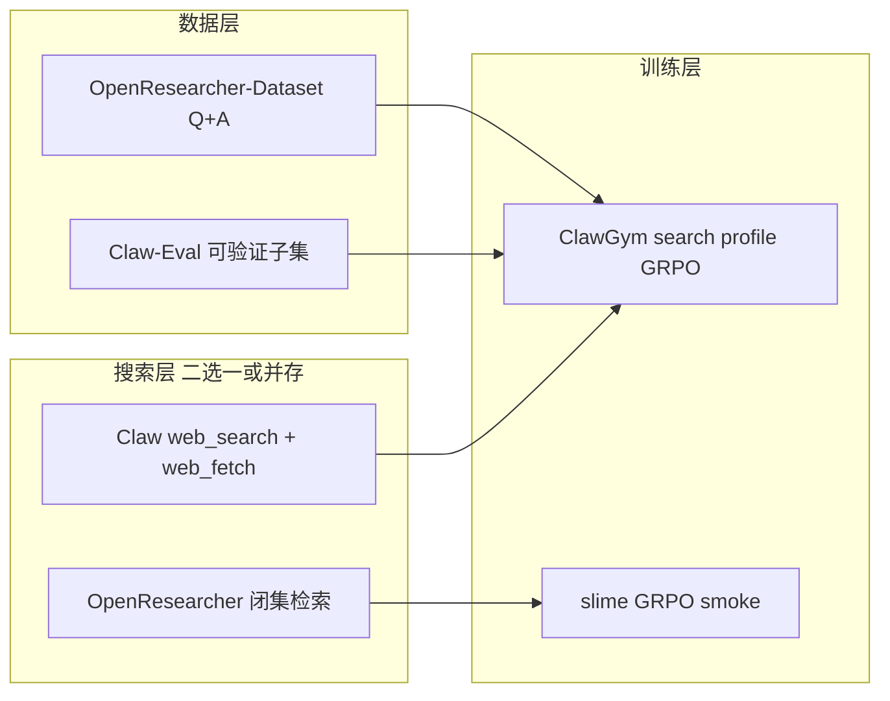

# OpenResearcher 环境构建指南（GPC · Claw 适配）

> Agent Search 能力提升项目 · 阶段 4 数据 + 阶段 5 环境  
> 版本：v0.3 | 日期：2026-09-03  
> **决策者认定**：OpenResearcher **参考价值较高**（闭集 Q+A + 本地检索 + 长程 tool 范式）；见 [important_references.md](./important_references.md)  
> 关联：[rl_search_data_landscape.md](./rl_search_data_landscape.md) · [phase5_train.md](../phases/phase5_train.md)

---

## 准备状态（2026-09-03）

**已准备 OpenResearcher 训练环境及训练数据**（GPC 本机 `/data/OpenResearcher/`），可用于 slime GRPO 闭集 rollout 接入。

| 项 | 路径 / 说明 | 状态 |
|----|-------------|------|
| conda 环境 | `openresearcher`（Java 21 + pyserini + faiss-cpu + tevatron） | ✅ |
| 题源 Q+A | `gold_doc/` — **6,102** 题 + gold_docs | ✅ |
| 训练语料 | `corpus/data/*.parquet` — ~1487 万 doc，~28GB | ✅ |
| Dense 索引 | `indexes/qwen3-embedding-8b/*.pkl` — ~114GB | ✅ |
| Embedding 模型 | `/data/models/Qwen3-Embedding-8B` | ✅ |
| 检索服务脚本 | `search_eval/bcp/setup_or_search_server.sh`、`start_search_or_dense.sh`、`verify_or_search_api.sh` | ✅ |
| Dense 检索 smoke | 本机 `:8700` 曾跑通 `/search` + `/get_content` | ✅（已停服释放内存） |

**⚠️ 部署约束：环境 + 语料 + 索引过重（运行时内存 ~350GB+，磁盘 ~150GB+），不宜与训练 / SGLang 长期同机混跑，需额外服务器常驻部署检索服务。**

| 规划 | 说明 |
|------|------|
| 检索专用机 | 目标根目录 `/mnt/code/gengpengchun/search_sever`（rsync 自 `/data/OpenResearcher/` + embedding 模型） |
| 训练机 | slime GRPO；rollout 内 `--search_url http://<检索机IP>:8700` |
| BCP 评测 | 与训练语料分离；BM25 @ `:8686`（~10 万 doc，轻量，可留在评测机） |

---

## 0. URL 速查（项目 + 数据）

### 0.0 配套关系

| 角色 | 数据集 | URL | 规模 / 说明 |
|------|--------|-----|-------------|
| **题源 Q+A** | OpenResearcher-Corpus-Gold-Doc | https://huggingface.co/datasets/OpenResearcher/OpenResearcher-Corpus-Gold-Doc | **6,102** 行；`query_id`, `query`, `answer`, `gold_docs` |
| **轨迹 + Q+A** | OpenResearcher-Dataset | https://huggingface.co/datasets/OpenResearcher/OpenResearcher-Dataset | **97,630** 行；6102 题 × 16 seed；含 `messages` |
| **检索语料** | OpenResearcher-Corpus | https://huggingface.co/datasets/OpenResearcher/OpenResearcher-Corpus | ~15M docs；gold 已 merge |
| **预计算索引** | OpenResearcher-Indexes | https://huggingface.co/datasets/OpenResearcher/OpenResearcher-Indexes | Qwen3-Embedding-8B pkl 分片 |
| **代码** | TIGER-AI-Lab/OpenResearcher | https://github.com/TIGER-AI-Lab/OpenResearcher | 检索服务、agent、评测 |
| **论文** | arXiv:2603.20278 | https://arxiv.org/abs/2603.20278 | — |

**评测专用（≠ 训练语料，默认脚本易误绑）**

| 资源 | URL |
|------|-----|
| BrowseComp-Plus corpus | https://huggingface.co/datasets/Tevatron/browsecomp-plus-corpus |
| BrowseComp-Plus indexes | https://huggingface.co/datasets/Tevatron/browsecomp-plus-indexes |
| Embedding 模型 Qwen3-Embedding-8B | https://huggingface.co/Qwen/Qwen3-Embedding-8B |
| Tevatron 依赖 | https://github.com/texttron/tevatron |

更多项目见 [rl_search_data_landscape.md §8](./rl_search_data_landscape.md#8-项目与数据-url-索引)。

---

## 0.1 目标与边界

### 0.1.1 我们要从 OpenResearcher 借鉴什么

| 借鉴 | 不照搬 |
|------|--------|
| 离线 corpus + dense 检索服务 | GPT-OSS native browser tool schema |
| Q+A 作 GRPO prompt/reward | Megatron SFT 训练栈（我们走 slime / ClawGym） |
| `search` → `open` → `find` 三阶段浏览抽象 | 强制保留 `find`（Claw 见 §6） |
| BrowseComp-Plus 闭集评测流程 | 默认脚本里的 BCP 语料当作训练语料（见 §3.2） |

### 0.1.2 GPC 目标架构（Claw 场景）



---

## 1. 硬件与依赖（OpenResearcher 官方参考）

| 项 | 建议 |
|----|------|
| GPU | 检索 dense：**≥15GB 显存**（Qwen3-Embedding-8B）；agent 评测另需多卡 |
| 存储 | Corpus ~30GB + index 分片；BrowseComp-Plus 评测库另计 |
| OS | Linux；OpenResearcher 文档：Python 3.12 + `uv` |
| Java | BrowseComp-Plus BM25 需 `openjdk-21-jdk` |

---

## 2. 数据准备

### 2.1 训练用 Q+A（RL prompt + reward）

**推荐题源（去重 6102 题）**：[OpenResearcher-Corpus-Gold-Doc](https://huggingface.co/datasets/OpenResearcher/OpenResearcher-Corpus-Gold-Doc)

**含多 seed 轨迹**：[OpenResearcher-Dataset](https://huggingface.co/datasets/OpenResearcher/OpenResearcher-Dataset) — RL 可按 `qid` 去重，或直接用 Gold-Doc 的 `query`/`answer`

```bash
# 题源 Q+A（6,102）
huggingface-cli download OpenResearcher/OpenResearcher-Corpus-Gold-Doc \
  --repo-type dataset \
  --local-dir /data/openresearcher/gold_doc

# 轨迹数据集（97K，可选）
huggingface-cli download OpenResearcher/OpenResearcher-Dataset \
  --repo-type dataset \
  --local-dir /data/openresearcher/dataset
```

**字段映射 → GRPO / slime parquet：**

| HF 字段（Dataset） | RL 用途 |
|---------|---------|
| `question` | user prompt |
| `answer` | `reward_model.ground_truth`（EM） |
| `qid` | `extra_info.index` |
| `messages` | **SFT 专用**；RL rollout 在线生成 |

| HF 字段（Gold-Doc） | RL 用途 |
|---------|---------|
| `query` | user prompt |
| `answer` | `reward_model.ground_truth` |
| `query_id` | `extra_info.index` |
| `gold_docs` | 分析 / 评测对照，非 RL 必需 |

**子集 smoke 建议**：先取 500–1000 条 `question`+`answer`，写 manifest：

```json
{
  "source": "OpenResearcher/OpenResearcher-Corpus-Gold-Doc",
  "split": "train",
  "indices": [0, 1, 2],
  "fields": ["qid", "question", "answer"]
}
```

### 2.2 离线语料 + 索引（闭集检索）

```bash
# 语料（~30GB，按需）
huggingface-cli download OpenResearcher/OpenResearcher-Corpus \
  --repo-type dataset \
  --local-dir /data/openresearcher/corpus

# 预计算 embedding 分片（与 Corpus 配套）
huggingface-cli download OpenResearcher/OpenResearcher-Indexes \
  --repo-type dataset \
  --local-dir /data/openresearcher/indexes
```

Corpus 行：`docid`, `text`, `url` — `open` 时按 url/docid 取全文。

### 2.3 与 TRACE 训练题的差异

- TRACE 在 **同一 corpus** 上按 Appendix A.4 **合成** multi-doc QA → **未公开 download**
- OpenResearcher-Dataset 题源为 **MiroVerse ~6K**，分布不同但 **同为长程 deep search**
- 要对标 TRACE 表数字：需后续自合成或等作者 release；**不阻塞** OpenResearcher env smoke

---

## 3. 搜索服务部署

### 3.1 OpenResearcher 仓库（推荐先 fork/clone 到 GPC 机器）

```bash
git clone https://github.com/TIGER-AI-Lab/OpenResearcher.git
cd OpenResearcher
sudo apt install -y openjdk-21-jdk
curl -LsSf https://astral.sh/uv/install.sh | sh
uv venv --python 3.12 && source .venv/bin/activate
git clone https://github.com/texttron/tevatron.git && cd tevatron && uv pip install -e . && cd ..
uv pip install -e .
bash setup.sh   # 下载 BrowseComp-Plus 评测相关（若跑 BCP eval）
```

### 3.2 ⚠️ 默认脚本绑定的语料（常见坑）

`scripts/start_search_service.sh` **默认**使用（评测闭集，非训练语料）：

- Corpus：[Tevatron/browsecomp-plus-corpus](https://huggingface.co/datasets/Tevatron/browsecomp-plus-corpus)
- Index：[Tevatron/browsecomp-plus-indexes](https://huggingface.co/datasets/Tevatron/browsecomp-plus-indexes)（bm25 或 qwen3-embedding-8b）

这是 **BrowseComp-Plus 评测** 用闭集，**不等于** OpenResearcher 训练 corpus。

**要对齐 TRACE / 训练语料**，需改环境变量指向 §2.2 路径，例如：

```bash
export CORPUS_PARQUET_PATH="/data/openresearcher/corpus/data/*.parquet"
export DENSE_INDEX_PATH="/data/openresearcher/indexes/qwen3-embedding-8b/*.pkl"
export DENSE_MODEL_NAME="Qwen/Qwen3-Embedding-8B"
export SEARCHER_TYPE="dense"
```

（具体变量名以 clone 后 `backend.py` / `start_search_service.sh` 为准；改前 diff 官方脚本。）

### 3.3 启动本地 dense 检索

```bash
# Terminal 1 — 检索服务（默认 port 8000）
bash scripts/start_search_service.sh dense 8000

# 验证（示例）
curl -s -X POST http://127.0.0.1:8000/search \
  -H 'Content-Type: application/json' \
  -d '{"query": "test query", "topn": 3}'
```

**性能**：大规模 Flat FAISS 可能 **数秒/query**；Issue #6 建议 **GPU Faiss**。RL 高并发需限流 + 缓存。

### 3.4 三工具语义（与 Claw 映射）

| OpenResearcher | 行为 | Claw 对应 | 备注 |
|----------------|------|-----------|------|
| `search` | 索引检索 → title/url/snippet | `web_search` | Claw 返回 SERP 摘要 |
| `open` | 按 URL 拉 **全文** | `web_fetch` | Claw 见 §6 截断限制 |
| `find` | 已打开页内 pattern 匹配 | **无原生等价** | POC 可省略；长页见 §6 |

Agent 侧：`browser.py` + `deploy_agent.py`；`browser_backend=local` 时 `search_url` 指本地 8000 服务。

### 3.5 开网模式（非闭集训练）

`browser_backend=serper` + `.env` 中 `SERPER_API_KEY` — 用于 BrowseComp/GAIA 等 **评测**，与 OpenResearcher 合成轨迹时的离线设定不同。

---

## 4. 训练数据接入

### 4.1 路径 A — slime GRPO smoke（与 OpenResearcher env 对齐）

1. 起 §3.3 检索服务  
2. 将 Dataset Q+A 转为 Search-R1 式 parquet（§2.1 字段映射）  
3. 新建 rollout：解析 `search`/`open`/`find` **或** 简化为 search+open 两工具  
4. 接 `slime_0427/slime/examples/search-r1/`，改 `max_turns`（TRACE 用 60；smoke 可 10–20）

**纯 GRPO baseline**：仅 outcome EM + format，不开 TRACE turn term（见 [trace_vs_abseeker_credit.md](./trace_vs_abseeker_credit.md) §6.3）。

### 4.2 路径 B — ClawGym search profile（GPC 主线）

1. `clawgym_rl_rollout.py`：`deny` 去掉 `web_search` / `web_fetch`（及按需 `memory_search`）  
2. 任务池：`data/search_rl_v1/tasks/` — 每 task 含 verifiable answer（可来自 OpenResearcher Q+A 或 Claw-Eval）  
3. Reward：现有 grader / EM  
4. 搜索后端：**Claw 真 web** 或 **mock SERP**（`claw_eval_new/.../mock_services/`）；与 OpenResearcher 闭集 **分池**

### 4.3 路径 C — 混合（建议阶段 5 中后期）

| 池 | 数据 | 环境 | 目的 |
|----|------|------|------|
| 闭集 | OpenResearcher Q+A 子集 | OR 本地检索 | 学 multi-hop retrieval，省 API |
| 开网 | Claw-Eval web 任务 | Claw web_search/fetch | 对齐生产工具 schema |

比例待 P4-H04 / D7 拍板；默认 **先独立子集**（R6）。

---

## 5. 评测对齐

| Benchmark | OpenResearcher 支持 | 搜索后端 |
|-----------|---------------------|----------|
| BrowseComp-Plus | ✅ `setup.sh` + local | dense/bm25 |
| BrowseComp / GAIA / xbench | ✅ | serper |

GPC 阶段 2 仍以 **Claw-Eval / QCB L2** 为主；BCP subset 作 **闭集对照**（D5）。

---

## 6. Claw 场景适配要点

### 6.1 工具：两工具 vs 三工具

**决策者/Agent 共识（2026-08-28）**：

- Claw 生产：`web_search` + `web_fetch` ≈ `search` + `open`
- **`find` 非必选**；`web_fetch` 读 Readability 正文后由模型直接推理
- **长页风险**：原生 `web_fetch` 仅 `maxChars` **从开头截断**（OpenClaw 默认 cap ~20k；ClawGym 默认 50k），**无法指定 offset/页内搜索**
- **待实测**：OpenResearcher corpus 与 Claw-Eval 页面的 **正文长度分布**；再定是否加 mock `find` 或扩展 fetch

### 6.2 Schema 与 SFT 格式

- OpenClaw tool JSON：`clawgym_tools.py` / `sft_data_pre_tokenize_toolcall_for_openclaw.py`  
- 勿混用 GPT-OSS `browser.*` recipient 格式与 Claw function call

### 6.3 RL 与 SFT 数据分工

| 来源 | SFT | RL |
|------|-----|-----|
| OpenResearcher `messages` | ✅ 长轨迹 | ❌ 不直接用于 on-policy |
| OpenResearcher Q+A | 可选 distillation | ✅ prompt + GT |
| Claw-Eval rollout | ✅ | ✅ 同 schema |

### 6.4 mock 与并行（ClawGym R6）

- 大规模 GRPO：`mock SERP` + query 缓存 + 低并发  
- OpenResearcher 闭集检索：**无外部 API**，适合 RL 内环；与 Claw mock **可并存于不同 task pool**

---

## 7. 分阶段 checklist

### Phase 4 — 数据与环境 smoke

- [x] 下载 Gold-Doc Q+A（6102）+ Corpus + Dense index 全量（`/data/OpenResearcher/`）  
- [ ] 下载 OpenResearcher-Dataset 轨迹（97K，**SFT 可选**，RL 非必需）  
- [x] 训练脚本指向 OR corpus（`start_search_or_dense.sh`，非 BCP 语料）  
- [x] 检索 API smoke（dense `:8700` `/search` + `/get_content`）  
- [ ] **额外服务器**部署常驻 dense 检索（`setup_or_search_server.sh` + rsync）  
- [ ] Q+A → parquet 转换脚本（50 条 smoke manifest）  
- [ ] 记录最长 `web_fetch` / `open` 正文长度（**待数据实测**）

### Phase 5 — 训练 env

- [ ] 检索服务迁至专用机并对外提供 `:8700`  
- [ ] ClawGym `search` profile 启用 web 工具  
- [ ] slime GRPO 闭集 smoke（OpenResearcher Q+A + remote search）  
- [ ] ClawGym GRPO 开网/mock smoke（Claw-Eval 子集）  
- [ ] 纯 GRPO baseline 再叠 MA-TRACE / turn credit（阶段 3 后）

---

## 8. 风险

| ID | 风险 | 缓解 |
|----|------|------|
| OR-E1 | 默认 BCP 语料 ≠ 训练 corpus | §3.2 显式改路径 |
| OR-E2 | 检索延迟 / RL 超时 | GPU Faiss、缓存、降并发 |
| OR-E6 | Dense 服务内存 ~350GB+，与训练同机冲突 | **专用检索机** rsync 部署；训练机 HTTP 远程调用 |
| OR-E3 | 工具 schema 不一致（R5） | 评测与训练均用 Claw schema；闭集仅作辅助池 |
| OR-E4 | web_fetch 截断丢证据 | 实测长度；必要时扩展 fetch 或 mock find |
| OR-E5 | TRACE 合成 QA 缺失 | 用 OR Dataset Q+A；TRACE credit 另 POC |

---

## 9. 参考链接

| 类型 | URL |
|------|-----|
| 代码 | https://github.com/TIGER-AI-Lab/OpenResearcher |
| 论文 | https://arxiv.org/abs/2603.20278 |
| 题源 Q+A（6102） | https://huggingface.co/datasets/OpenResearcher/OpenResearcher-Corpus-Gold-Doc |
| 轨迹 Dataset（97K） | https://huggingface.co/datasets/OpenResearcher/OpenResearcher-Dataset |
| 检索 Corpus | https://huggingface.co/datasets/OpenResearcher/OpenResearcher-Corpus |
| 预计算 Indexes | https://huggingface.co/datasets/OpenResearcher/OpenResearcher-Indexes |
| BCP 评测 corpus | https://huggingface.co/datasets/Tevatron/browsecomp-plus-corpus |
| BCP 评测 indexes | https://huggingface.co/datasets/Tevatron/browsecomp-plus-indexes |
| Embedding 模型 | https://huggingface.co/Qwen/Qwen3-Embedding-8B |
| Tevatron | https://github.com/texttron/tevatron |
| Claw web_fetch 文档 | OpenClaw `docs/tools/web-fetch.md`（参数：`url`, `extractMode`, `maxChars`） |

---

## 变更记录

| 日期 | 变更 |
|------|------|
| 2026-08-28 | 初稿：OpenResearcher 数据/检索/训练接入；Claw 两工具适配；BCP 语料坑；checklist |
| 2026-08-28 | v0.2：§0 URL 速查；6102 题 Corpus-Gold-Doc；Indexes 下载命令修正 |
| 2026-09-03 | v0.3：§准备状态 — 训练环境/数据已就绪；dense 过重需额外服务器部署 |
