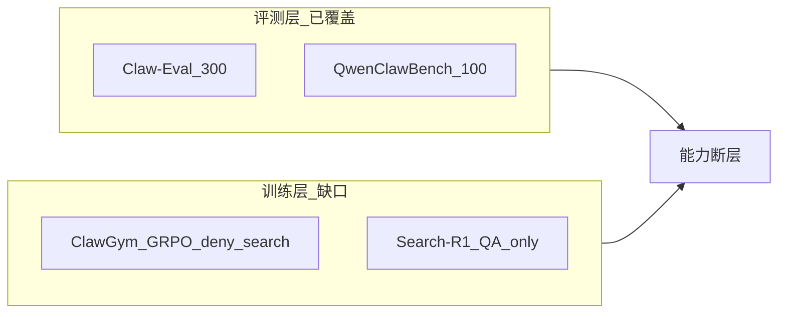

# Search Capability Landscape Report

> Agent Search 能力提升项目 · 阶段 1 交付物  
> 版本：v0.1 初稿 | 日期：2026-08-26 | 作者：Agent（待人工评审 P1-H02）

---

## 1. Executive Summary

本项目目标是在 OpenClaw agent 上提升 **web_search、memory_search（KB/RAG）、浏览器浏览** 三类多轮搜索能力。调研结论如下：

1. **业界趋势**：2025 年搜索能力训练从「静态 RAG + prompt」转向 **RL 驱动的多轮 search/browse 交错**（Search-R1、RAG-R1、DeepResearcher、WebAgent 生态）。
2. **GPC 现状**：评测层（Claw-Eval、QwenClawBench）已覆盖 web/KB 任务；训练层 ClawGym RL **显式禁用** `web_search`/`memory_search`，Search-R1 示例仅面向 QA、未接入 OpenClaw tool schema——存在 **「评测有、训练无」** 断层。
3. **推荐 shortlist（供阶段 3 决策）**：
   - **路线 A（优先）**：Claw-Eval/QCB 强模型轨迹 SFT + ClawGym **search profile** GRPO
   - **路线 B**：Search-R1 QA GRPO → OpenClaw schema 迁移 SFT
   - **路线 C**：纯 SFT/DPO（低成本验证）
   - **路线 D（分阶段）**：Browser 专项 SFT，与 A 并行 POC
4. **能力实施顺序建议（D1）**：**先 web + KB，browser 分阶段**；browser 评测与数据最薄弱。
5. **阶段 2 优先**：Claw-Eval web/KB 子集 + QCB Research/Memory baseline；HotpotQA subset 作 L1 辅助。

---

## 2. 调研范围与方法

### 2.1 范围

| 维度 | 覆盖 |
|------|------|
| 能力 | web 搜索、知识库检索、浏览器交互 |
| 方法 | RL、SFT、DPO、RAG、数据合成 |
| 来源 | arXiv/GitHub 2024–2025 代表工作 + GPC 仓库内代码 |

### 2.2 方法

- 文献与开源项目检索（Search-R1、DeepResearcher、WebAgent、RAG-R1 等）
- 精读 GPC 内 Search-R1 slime 示例、ClawGym RL 配置、Claw-Eval KB/web 任务
- 按「方法 × web/KB/browser × 与 OpenClaw 集成难度」矩阵对比

### 2.3 集成难度定义

| 等级 | 含义 |
|------|------|
| **低** | 改 ClawGym/slime 配置或 profile 即可 |
| **中** | 需新 rollout 脚本或 chat template 迁移，评测栈可复用 |
| **高** | 需真实 web 多 agent 环境、大量轨迹合成 |

图例（能力覆盖）：● 直接支持 ○ 间接/需改造 △ 部分 — 不适用

---

## 3. 方向 A — 开放域 QA 搜索 RL

### 3.1 Search-R1

| 项 | 内容 |
|----|------|
| 论文 | [arXiv:2503.09516](https://arxiv.org/abs/2503.09516) |
| 代码 | [PeterGriffinJin/Search-R1](https://github.com/PeterGriffinJin/Search-R1) |
| 方法 | 多轮 reasoning 与 search 交错；`<search>` / `<answer>` tag；**retrieved token masking** 稳定 RL；outcome EM reward |
| RL | PPO / GRPO / Reinforce |
| 数据 | NQ、HotpotQA、TriviaQA、PopQA、2Wiki、Musique、Bamboogle 等 7 个 QA 集 |
| 检索 | 本地 sparse/dense（FAISS wiki-18 ~132GB）或在线 Google/Bing/Serper |
| 效果 | Qwen2.5-7B 相对 RAG baseline 提升约 26–41%（设置不同） |
| GPC | [`slime_0427/slime/examples/search-r1/`](../../../slime_0427/slime/examples/search-r1/)：Qwen2.5-3B、`max_turns=2`、local/google 后端；**未适配 Qwen3.5 / OpenClaw tool call** |

### 3.2 RAG-R1

| 项 | 内容 |
|----|------|
| 论文 | [arXiv:2507.02962](https://arxiv.org/abs/2507.02962)（AAAI 2026） |
| 代码 | [inclusionAI/AWorld-RL/RAG-R1](https://github.com/inclusionAI/AWorld-RL/tree/main/RAG-R1) |
| 方法 | 两阶段：格式学习 SFT + 检索增强 RL；**multi-query 并行**降低延迟 |
| 特点 | 自适应使用内部知识 vs 外部检索 |
| 数据 | 7 个 QA benchmark；KILT Wikipedia + BGE retriever |
| GPC | 与 Search-R1 同系（veRL）；可借鉴并行 search，需独立接入 |

### 3.3 R1-Searcher

| 项 | 内容 |
|----|------|
| 代码 | [RUCAIBox/R1-Searcher](https://github.com/RUCAIBox/R1-Searcher) |
| 方法 | **两阶段** RL：先学搜索格式，再优化检索策略 |
| 用途 | QA 搜索冷启动备选 |

### 3.4 ReSearch

| 项 | 内容 |
|----|------|
| 代码 | [Agent-RL/ReSearch](https://github.com/Agent-RL/ReSearch) |
| 方法 | Search-R1 系变体，多轮 search + RL |
| 用途 | 对比参考 |

### 3.5 经典基线：ReAct / Toolformer / WebGPT

| 工作 | 要点 | 与项目关系 |
|------|------|------------|
| **ReAct** (2022) | Thought → Action → Observation 交错 | OpenClaw 多轮 tool 的理论基础 |
| **Toolformer** (2023) | 自监督 tool call 学习 | SFT 冷启动参考 |
| **WebGPT** (2021) | 浏览 + 引用答案 | 早期 web agent；BrowseComp 前身思路 |

---

## 4. 方向 B — Agent 级 Web 搜索 / 浏览

### 4.1 DeepResearcher

| 项 | 内容 |
|----|------|
| 论文 | [arXiv:2504.03160](https://arxiv.org/abs/2504.03160) |
| 代码 | [GAIR-NLP/DeepResearcher](https://github.com/GAIR-NLP/DeepResearcher) |
| 方法 | **真实 web** 环境端到端 GRPO；search + **browse 子 agent** 读网页 |
| 与 RAG-RL 区别 | 不假设固定 corpus，处理开放 web 噪声 |
| 效果 | 较 prompt 基线 +28.9pt；较 RAG-based RL +7.2pt |
| 涌现行为 | 规划、交叉验证、自我反思、诚实拒答 |
| GPC | **最接近** OpenClaw web_search + 浏览器目标；集成难度 **高**（多 agent、真实 API） |

### 4.2 WebAgent 生态（阿里 Tongyi）

| 组件 | 要点 |
|------|------|
| **WebWalker** (ACL 2025) | Web 遍历 benchmark + 多 agent 信息寻求 |
| **WebDancer** (NeurIPS 2025) | 四阶段：数据构建 → 轨迹采样 → SFT 冷启动 → RL；ReAct + Search/Visit 工具 |
| **WebSailor** | RL 强化 web 推理；BrowseComp 等 SOTA |
| **WebShaper** | 形式化驱动的 search 数据合成 |
| **WebWatcher** | 视觉 + 多模态 deep research |
| 评测 | GAIA、WebWalkerQA、BrowseComp |
| GPC | 工具为 Search/Visit，与 OpenClaw `web_search`/`web_fetch` **schema 不同**；数据合成与 SFT+RL 范式可借鉴 |

### 4.3 BrowseComp / SimpleQA

| Benchmark | 说明 |
|-----------|------|
| **BrowseComp** | OpenAI 高难度 browse 评测；需多步 web 搜索 |
| **SimpleQA** | 事实性 QA，测 hallucination |
| GPC | **无 harness**；阶段 2 P1 接入候选 |

### 4.4 OpenClaw 原生

| 工具 | 说明 |
|------|------|
| `web_search` | Brave / SERP 等 |
| `web_fetch` | URL 内容抓取 |
| 浏览器链 | 部分任务需深度读页 |
| GPC 评测 | Claw-Eval ~93 web 相关任务；QCB 7 Research |
| GPC 训练 | ClawGym RL **deny** 上述搜索工具（见第 8 节） |

---

## 5. 方向 C — 知识库 / RAG 检索

### 5.1 Self-RAG

| 项 | 内容 |
|----|------|
| 论文 | [Asai et al., 2023](https://arxiv.org/abs/2310.11511) |
| 方法 | 生成 retrieval/on-topic/support 等 **反思 token**；自适应决定是否检索 |
| 与 memory_search | 均需「何时搜、搜什么」决策；训练方式不同（Self-RAG 非 RL 为主） |
| GPC | 集成难度 **高**；可作 reward 设计参考 |

### 5.2 RAG-R1

见 3.2；强调 **内外知识切换** + 并行 query，与 `memory_search` vs `web_search` 路由问题相关。

### 5.3 tau2-bench banking_knowledge

| 项 | 内容 |
|----|------|
| 路径 | `tau2-bench/src/tau2/domains/banking_knowledge/` |
| 方法 | BM25 检索 + 多轮 tool 对话 |
| GPC | 仓库内 **可运行** KB 检索域；可复用于 KB RL 冒烟 |

### 5.4 OpenClaw memory / workspace RAG

| 项 | 内容 |
|----|------|
| 工具 | `memory_search`、`memory_read`、workspace 向量索引 |
| 评测 | Claw-Eval T015/T016 kb_search；QCB ~16 Knowledge/Memory 任务 |
| 训练 | RL 阶段 `memory_search` 在 deny 列表 |

---

## 6. 方向 D — 浏览器 / GUI Agent

### 6.1 OSWorld / GUI-RL

| 项 | 内容 |
|----|------|
| OSWorld | 桌面环境截图 + 键鼠操作 benchmark |
| GPC | [`OpenClaw-RL/gui-rl/`](../../../OpenClaw-RL/gui-rl/) 有 Qwen3-VL GUI RL 参考 |
| 与 web browser | OSWorld 偏桌面；OpenClaw browser 更偏 URL/页面 |

### 6.2 WebArena / Mind2Web

| 项 | 内容 |
|----|------|
| WebArena | 真实网站交互（购物、论坛等） |
| Mind2Web | 网页操作数据集 |
| GPC | 无 harness；L3 后期接入 |

### 6.3 Claw-Eval mock_services

| 项 | 内容 |
|----|------|
| 路径 | `claw_eval_new/claw-eval/mock_services/web_real/` |
| 用途 | Mock SERP、降低 RL 训练 API 延迟与成本 |
| 建议 | 搜索 RL **独立子集** + mock + 缓存（见 R6 缓解） |

### 6.4 QCB browser 相关

约 3 个任务（如 `task_00033_ai_browser_project_*`）；数据与评测均 **最薄弱**。

---

## 7. 方向 E — 数据合成与蒸馏

### 7.1 BFCL 多轮合成

| 项 | 内容 |
|----|------|
| 路径 | `simulator_tool_sever_bfcl_revise_fix/pipeline.py` |
| 方法 | 模拟器 + 强模型 rollout → 多轮 tool JSONL |
| 借鉴 | 扩展为 search 工具域的合成 pipeline |

### 7.2 travel_synth / DPO

| 项 | 内容 |
|----|------|
| 路径 | `travel_synth/`、`on_policy_dpo_loop/` |
| 方法 | 随机任务 → 强模型 rollout → DPO pair |
| 借鉴 | 搜索任务正负轨迹（好/坏 search 策略） |

### 7.3 WebShaper / AgentTrek

| 项 | 内容 |
|----|------|
| WebShaper | 信息寻求形式化 → 自动合成 QA+search 轨迹 |
| AgentTrek | Web 轨迹合成 |
| 用途 | Browser / 长程 web SFT 数据来源（阶段 4） |

### 7.4 强模型 rollout（Claw-Eval / QCB）

| 项 | 内容 |
|----|------|
| 数据 | 真实 agent 任务 + 自动 grader |
| 优势 | 与 OpenClaw tool schema **一致**；路线 A 核心数据源 |
| 成本 | 强模型 API；需人批（P1-H03） |

---

## 8. GPC 代码库集成评估

### 8.1 架构断层



### 8.2 关键代码事实

**ClawGym RL 禁用搜索**（`clawgym_rl_rollout.py`）：

```545:548:clawGym/ClawGym-Agents/RL/clawgym_rl_rollout.py
        "tools": {
            "profile": "coding",
            "deny": ["web_search", "memory_search"],
            "exec": {"host": "gateway", "security": "full"},
```

**训练集排除 web**（`DATASET_README.md`）：2000 任务刻意去掉 `web_search`/`web_fetch`，原因是大规模并行时网络工具导致级联超时。

**Search-R1 slime 实现**（`generate_with_search.py`）：

- Tag 式 `<search>` / `<answer>`，非 OpenClaw JSON tool call
- `max_turns=2`，`search_backend`: local（FAISS）或 google（Serper）
- Reward：`compute_score_em` + `format_score=0.2`
- 并发 `search_concurrency=256`（QA 场景；agent RL 需降低）

**Claw-Eval KB 任务**（T016）：mock `kb_search` + `kb_get_article`，与 OpenClaw `memory_search` 概念类似但 **工具名不同**。

**QCB 任务分布（扫描）**：

| 类别 | 约数量 |
|------|--------|
| Research and Information Retrieval | 7 |
| Knowledge and Memory | 16 |
| Browser 相关 | 3 |

### 8.3 集成路径对比

| 组件 | 现状 | 启用搜索需做 |
|------|------|--------------|
| ClawGym GRPO | 9B Ornith 主线 | 新增 `search` profile；独立任务池；mock SERP |
| slime Search-R1 | Qwen2.5-3B 示例 | Qwen3.5 template；可选转 OpenClaw schema |
| SFT pipeline | 含 memory/web schema | 灌入搜索轨迹即可 |
| Claw-Eval runner | 完整 | 阶段 2 包装为 `search_eval/` |
| gui-rl | 桌面 GUI | Browser 专项，与 search profile 分开 |

---

## 9. 对比总表

| 方法 | web | KB | browser | Reward | 训练数据 | 模型规模 | 开源 | GPC集成 |
|------|-----|----|---------|--------|----------|----------|------|---------|
| Search-R1 | ○ | — | — | EM | NQ/HotpotQA 等 | 3B–7B | 是 | 中 |
| RAG-R1 | ○ | ● | — | EM | 7 QA + KILT | 7B | 是 | 中 |
| R1-Searcher | ○ | — | — | EM | QA | 7B+ | 是 | 中 |
| DeepResearcher | ● | △ | ● | outcome | QA + 真实 web | 7B | 是 | 高 |
| WebSailor/WebDancer | ● | — | ● | RL+SFT | 合成 web | 3B–32B | 是 | 高 |
| ClawGym GRPO | △ | △ | — | task reward | ClawGym 2000 | 9B | 是 | **低** |
| Self-RAG | — | ● | — | 自评 token | 自建 | 7B+ | 是 | 高 |
| SFT 蒸馏 (QCB/Claw-Eval) | ● | ● | △ | — | agent 任务 | 9B+ | — | **低** |
| DPO 搜索策略 | ● | ● | — | preference | rollout pair | 9B | — | 低 |
| tau2 KB 域 | — | ● | — | task | banking | — | 是 | 中 |
| BFCL 式合成 | △ | △ | — | sim reward | 合成多轮 | 9B | 是 | 中 |
| OpenClaw prompt-only | ● | ● | ● | — | — | 9B | — | 已部署 |

---

## 10. 推荐 Shortlist

### 路线 A — Agent SFT + ClawGym search GRPO（**推荐优先**）

| 项 | 内容 |
|----|------|
| 步骤 | ① Claw-Eval/QCB 搜索任务强模型 rollout → SFT ② 新建 search profile 启用 web/memory ③ 搜索专项 GRPO（与 2000 任务分池） |
| 集成难度 | **低–中** |
| 优点 | 与 Ornith/ClawGym 栈一致；评测=训练 tool schema |
| 风险 | web 并行超时 → mock SERP + 限并发（R6） |
| 依赖 | SERP key、强模型 rollout API（人批） |

### 路线 B — Search-R1 QA RL → Schema 迁移

| 项 | 内容 |
|----|------|
| 步骤 | ① HotpotQA/NQ 上 slime GRPO ② SFT 迁移到 OpenClaw tool call |
| 集成难度 | **中** |
| 优点 | RL 信号清晰；仓库有示例 |
| 风险 | QA → agent **域迁移 gap**（R3）；L2 提升不确定 |
| 依赖 | Serper 或 wiki-18 索引（D6） |

### 路线 C — 纯 SFT/DPO

| 项 | 内容 |
|----|------|
| 步骤 | 搜索轨迹蒸馏 + DPO 正负策略对比（travel_synth 模式） |
| 集成难度 | **低** |
| 优点 | 快、省算力 |
| 风险 | 上限可能低于 RL（R2 部分缓解：仍可做 DPO 再 RL） |

### 路线 D — Browser 专项（分阶段）

| 项 | 内容 |
|----|------|
| 步骤 | gui-rl + WebAgent 数据范式；独立 SFT；后期与 A 混合 |
| 集成难度 | **中–高** |
| 优点 | 覆盖 browser 能力 |
| 风险 | 数据 scarce（R4）；无 WebArena harness |

### 不推荐作为 v1 主线

- **DeepResearcher 全量复刻**：工程与 API 成本过高，可作长期参考
- **Self-RAG 从头训练**：与 OpenClaw 工具链差异大

---

## 11. 对阶段 2–3 的建议

### 11.1 Benchmark 优先级

| 优先级 | 套件 |
|--------|------|
| P0 | Claw-Eval web/KB curated 子集、QCB Research+Memory |
| P1 | HotpotQA/NQ dev 100（Search-R1 EM） |
| P1 | BrowseComp subset（需新 harness + API 成本） |
| P2 | WebArena、GAIA 全量 |

### 11.2 冒烟测试顺序（阶段 3）

1. SM-SFT-100：OpenClaw 搜索轨迹格式
2. SM-CG-WEB-10：search profile + mock SERP 稳定性
3. SM-R1-50：QA GRPO 链路（若选路线 B）
4. SM-BRW-5：browser schema（若 D1 含 browser POC）

### 11.3 外部依赖建议（待人批 P1-H03）

| 依赖 | 建议 |
|------|------|
| SERP/Brave | **批** — Claw-Eval baseline 必需 |
| Serper | 冒烟可选；QA RL 若走路线 B |
| wiki-18 132GB | **暂不批** 为默认；D6 可选 |
| 强模型 rollout | **批** 有限额度 — SFT 数据 |

---

## 12. 参考文献与链接

| 资源 | URL |
|------|-----|
| Search-R1 | https://arxiv.org/abs/2503.09516 |
| DeepResearcher | https://arxiv.org/abs/2504.03160 |
| RAG-R1 | https://arxiv.org/abs/2507.02962 |
| WebDancer | https://arxiv.org/abs/2505.22648 |
| WebWalker | https://arxiv.org/abs/2501.07572 |
| Self-RAG | https://arxiv.org/abs/2310.11511 |
| ReAct | https://arxiv.org/abs/2210.03629 |
| GPC Search-R1 示例 | `slime_0427/slime/examples/search-r1/` |
| GPC Claw-Eval | `claw_eval_new/claw-eval/` |
| GPC 任务状态 | `docs/agent_search/TASK_STATUS.md` |

---

## 附录：人工评审检查清单

- [ ] 五方向代表工作是否足够？需补充的工作：__________
- [ ] Shortlist 路线优先级是否同意？
- [ ] D1：能力顺序是否采纳「先 web+KB，browser 分阶段」？
- [ ] D2 倾向：A / B / C / 组合？
- [ ] 外部依赖审批（P1-H03）

**评审人**：__________ **日期**：__________
