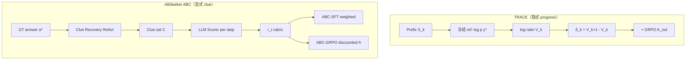

# TRACE vs ABSeeker：长程 Search Agent 的 Credit 分配深度对比

> Agent Search 能力提升项目 · Credit 分配专篇  
> 版本：v0.2 | 日期：2026-08-27  
> 论文：[TRACE](https://arxiv.org/html/2607.13988) · [ABSeeker](https://arxiv.org/html/2608.05102)  
> **TRACE 状态**：⭐ 重要参考文献 · **决策者已精读**（2026-08-27）· 见 [important_references.md](./important_references.md)

---

## 0. 为什么这两篇值得对着读

它们解决 **同一个痛点**，但给出了 **两种正交的 credit 哲学**：

| | TRACE | ABSeeker (ABC) |
|--|-------|----------------|
| Credit 从哪来 | **隐式**：冻结 ref model 对 gold answer 的可预测性 | **显式**：GT 反推 clue + LLM rubric 逐步打分 |
| 额外模型 | 训练初 checkpoint（自己） | DeepSeek-V4-Flash（scorer + clue recovery） |
| 训练路径 | **纯 RL**（无 SFT 冷启动） | **ABC-SFT → ABC-GRPO** |
| 对失败轨迹 | 有用步若提高 \(V_k\) 仍得正 credit | 发现 clue 仍 +0.8，即使最终答错 |
| 对成功轨迹 | 冗余步 \(\delta_k\approx 0\)，不 inflate | 错 dismiss clue 仍 -0.8 |

下面按「问题 → 机制 → 公式 → 训练接入 → 效果 → 风险 → GPC」展开。

---

## 1. 共同问题：轨迹级 supervision 的两种失败

长程 search 轨迹 \(\tau = (s_1,\ldots,s_T, a)\) 通常只有 **一个终点 reward** \(r_{\text{ans}} \in \{0,1\}\)（或 EM/F1）。

这会导致：

**Failure mode A（失败轨迹里的好步被误杀）**  
轨迹最终答错 → 全轨迹负 advantage → 但其中可能有「搜到了关键实体 / 打开了正确 URL」的步骤。

**Failure mode B（成功轨迹里的烂步被误奖）**  
轨迹最终答对 → 全轨迹正 advantage → 但其中可能有「错误排除候选 / 冗余重复搜索 / 中途走偏又拉回」的步骤。

TRACE 和 ABSeeker 都 explicitly 针对 A/B；差异在于 **如何定义「这一步好不好」**。

---

## 2. TRACE：用 ref model 探测 prefix 的「答题就绪度」

### 2.1 核心直觉

> 若当前对话 prefix 已经收集了足够证据，**同一个 frozen LLM** 在给定 prefix 下生成 **gold answer** 应该 **更容易**（更高 log-prob）。

不需要人工 process label，不需要另训 PRM，不需要从 GT 反推 clue 清单——只要训练时有 \(y^\*\) 即可。

### 2.2 状态切分

在 **每次 tool call 边界** 切 state \(S_k\)：  
\(S_k\) = 从问题到第 \(k\) 次 tool observation 结束时的 **模型可见 prefix**（与 AxisAgentic state-faithful 思想一致）。

轨迹：\(\tau = (x, a_1, o_1, \ldots, a_T, o_T, \hat{y})\)

### 2.3 价值函数（不是学出来的 critic）

**Step 1 — prefix 上 gold answer 的平均 log-prob：**

\[
\bar{\ell}_k = \frac{1}{|y^\*|}\sum_{t=1}^{|y^\*|} \log \pi_{\text{ref}}(y^\*_t \mid S_k, y^\*_{<t})
\]

\(\pi_{\text{ref}}\) = **训练初始 policy 的拷贝**，全程冻结。

**Step 2 — log-ratio state value（归一化「还剩多少 gap」）：**

\[
d_k = -\bar{\ell}_k + \epsilon, \quad V(S_k) = \log\frac{d_0}{d_k}
\]

- \(V(S_0)=0\)
- \(V(S_k)\) 越大 → 相对起点，answer likelihood gap 关闭越多
- 用 ratio 而非 raw \(\Delta\bar{\ell}\)：避免「离答案还很远时的小幅提升」和「快接近答案时的同等 raw 提升」被等同对待

**Step 3 — 一步 TD credit：**

\[
\delta_k = V(S_{k+1}) - V(S_k) = \log\frac{d_k}{d_{k+1}}
\]

性质（论文强调）：

- \(\delta_k > 0\)：这次 tool 交互让 gold answer **更可预测**
- \(\sum_k \delta_k = V(S_T)-V(S_0)\)：**telescoping** → 中间冗余步不能无限堆高总 credit
- 搜到链接但还没 open 时 \(\delta_k\) 可能小；decisive evidence 在后续 open/find 才体现 → 需要 **K-step backup**

### 2.4 K-step backup + 终点锚定

\[
c^{(K)}_{g,k} = \frac{1}{Z_{g,k}}\sum_{u=k}^{h_{g,k}} \gamma_{\text{td}}^{u-k} \delta_{g,u}, \quad h_{g,k}=\min(k+K-1, T_g-1)
\]

\[
r^{\text{turn}}_{g,k} = c^{(K)}_{g,k} + \mathbf{1}[h_{g,k}=T_g-1]\,\lambda_{\text{term}}\,\gamma_{\text{td}}^{T_g-k}\,A^{\text{out}}_g
\]

- 默认 **\(K=3, \gamma_{\text{td}}=0.8, \lambda_{\text{term}}=2.0\)**
- 最后一几轮 tool turn 还会 **注入 GRPO outcome advantage** 做 terminal anchor

### 2.5 与 GRPO outcome 混合（关键实现细节）

Outcome advantage（组内归一化，标准 GRPO）：

\[
A^{\text{out}}_g = \frac{R_g - \bar{R}}{\sigma_R}
\]

Per-token advantage（tool 交互 token）：

\[
\hat{A}_{g,t} = \alpha_{\text{out}} A^{\text{out}}_g + \alpha_{\text{turn}} r^{\text{turn}}_{g,\text{turn}(t)}
\]

**默认 \(\alpha_{\text{out}}=1.0, \alpha_{\text{turn}}=0.2\)** — turn credit 是 **辅助信号**，不能压过最终对错。

注意：**turn reward 不做 group normalize**（每条轨迹局部计算），避免不同长度/难度轨迹的 turn 信号被洗掉。

### 2.6 _walkthrough 例子_

| 轮次 | 动作 | 直觉 | \(\delta_k\) |
|------|------|------|-------------|
| 1 | search 泛关键词 | 略有信息 | 小正 |
| 2 | open 错页 | 噪声 | **负** |
| 3 | search 精确实体 | 候选链接 | 小正 |
| 4 | open 关键页 | 决定性证据进 context | **大正** |
| 5 | 重复 search 同 query | gap 不变 | **≈0** |

即使轮 5 后最终答错（\(A^{\text{out}}<0\)），轮 4 仍可能得到 **正的 \(r^{\text{turn}}\)**。

### 2.7 训练配置摘要

| 项 | 值 |
|----|-----|
| 数据 | OpenResearcher corpus 上 **合成多文档链式检索题**（比 HotpotQA 更长程） |
| 环境 | FAISS + `browser.search/open/find` |
| 模型 | Qwen3-4B/30B-A3B Thinking |
| **无 SFT 冷启动** | 直接从 base RL |
| Rollout | 8/prompt，最多 60 tool turns |
| \(\epsilon_{\text{train}}\) | 0.1 |

### 2.8 效果（controlled RL）

BrowseComp-Plus（闭集）Qwen3-4B：**7.2 → 35.6**（GRPO 30.0）；30B-A3B：**8.4 → 42.6**（GRPO 36.4）。

Ablation 要点：

- 无 K-step backup（\(K=0\)）≈ 纯 GRPO（30.0）
- log-ratio 形式 > raw delta > remaining gap
- \(\alpha_{\text{turn}}\) 太大（5–10）反而掉分 — turn 信号不能喧宾夺主

### 2.9 优势与风险

**优势**

- **零额外标注 / 零 rubric 工程**：只需 GT 字符串
- ref model **即自己**，无 teacher-student 漂移（scorer 不随 policy 变）
- telescoping 天然 **反 padding / 反冗余步刷分**
- 纯 RL Recipe 短，适合验证 ClawGym search profile

**风险**

- Credit 绑定 **「ref 能否预测 gold 字符串」**，不是 **「这一步 search 策略是否最优」**
- ref 与 policy 相同时，\(\pi_{\text{ref}}\) 对 prefix 的敏感度可能 **低估** policy 已学会但 ref 尚未跟上的模式（论文用 step-0 checkpoint 缓解）
- **短答案 QA** 适用；长报告 / OpenClaw 开放式任务需改 value target
- 闭集 FAISS 训练 → 开网 transfer 有限（BrowseComp open 仍只有个位数到 low teens）

### 2.10 Turn reward 复现疑问（决策者精读 · 2026-08-27）

以下问题 **正文未答清**，复现 TRACE turn auxiliary 前须澄清或 ablation（详见 [important_references.md](./important_references.md) TRACE-Q1～Q3）。

**1. `final-answer opener` 未解释清楚**

- §2.1：scoring 时在 \(S_k\) 后加 **final-answer opener**，再 teacher-force GT 算 Eq.(5)
- 正文 **未给出 opener 具体 token**；Appendix A.3 无完整 prompt；实现指 Search-R1 script（未公开）
- [Pith 外评 Minor #4](https://pith.science/paper/2607.13988)：要求明确 opener 构造及是否 **每个** \(S_k\) 都包含

**2. 思考模型：不能直接 `S_k + golden_answer`**

- 实验 backbone 为 **Qwen3-Thinking**；rollout 每轮含 private reasoning，最终交卷前另有 thinking
- 论文 **未说明** scoring 是否在 opener 与 GT 之间保留 ``（或等价标签）
- 若实现为「多轮 prefix 后直接拼 GT」，则相对真实生成路径 **丢失 final thinking 结构**，\(\bar{\ell}_k\) 可能 OOD

**3. 与 Pith Major #1 叠加**

- Ref scorer 的 prefix **含 policy 自身 reasoning**（Algorithm 1 无 mask）→ 存在 CoT 泄露 GT 刷 \(\delta_k\) 的风险

**GPC POC 前置**

- 书面定义 scoring token 序列（对齐 ClawGym/Qwen3 chat template）
- opener ± 固定 thinking 壳 ablation；禁止未文档化的裸拼 GT

---

## 3. ABSeeker：用 GT 反推 clue，显式 rubric 逐步打分

### 3.1 核心直觉

> Search 任务一旦知道 \(y^\*\)，问题 **可反向分解** 为必须发现的中间 clue（实体、日期、关系）。  
> 用 **固定 clue 集合** 当锚点，逐步判断 agent 是在 **发现 / 验证 / 排除 / 误杀** 哪条证据链。

这是 **process supervision**，但 clue 来自 **Answer-Backtracked Recovery**，不是人工逐步标注。

### 3.2 Stage 1：Answer-Backtracked Clue Recovery

输入：\((q, a^\*)\)

过程：DeepSeek-V4-Flash 以 **ReAct + web search** 从答案 **往回查**，产出 clue 集合 \(\mathcal{C}=\{c_1,\ldots,c_K\}\)（实体、事实、关系，且尽量 cite 网页）。

要点：

- Recovery **本身也是 agent loop**（不是纯 LLM 编造 clue）
- Clue 与 BrowseComp 类 **多约束题** 结构匹配（每条约束 → 潜在 clue）
- **每题 offline 算一次**，RL 过程中 clue 固定 → scorer 标准稳定

### 3.3 Stage 2：Clue-Anchored Step Scoring

对轨迹每一步 \(s_t\)（reasoning + tool call + tool response），scorer 读 \((q, \mathcal{C}, s_t)\)，按 rubric 加减分：

| 行为 | \(\Delta\) |
|------|-----------|
| Baseline | 1.0（无 obvious error 就不罚） |
| 发现/验证正确 clue | +0.8 |
| 正确排除错误候选 | +0.4 |
| **错误 dismiss 正确 clue** | -0.8 |
| 提交正确答案 | +1.0 |
| 提交错误答案 | -1.0 |

\[
r_t = \text{clip}\left(1.0 + \sum_{j\in\mathcal{A}_t}\Delta_j,\ 0,\ 2.0\right)
\]

**同一 step 可叠加多个 \(\Delta\)**（例如一步验证两个 clue → clip 到 2.0）。

Walkthrough（论文 CeraVe 例）：

- Step 22：发现 Ceramides → CeraVe 链接 → **1.8**
- Step 35：验证 L'Oréal 收购 + 创始人毕业年份 → **2.0**（clip）
- Step 56：抛弃 CeraVe 证据回到错误候选 → **0.2**
- Step 64：提交错误最终答案 → **0.0**

### 3.4 Stage 3a：ABC-SFT

\[
\mathcal{L}_{\text{SFT}}(\theta) = -\sum_{t=1}^{T} w(r_t) \sum_j \log p_\theta(x_{t,j}\mid x_{t,<j})
\]

\[
w(r_t) = 2\sigma(2(r_t - 1)) \quad \text{（中性 } r_t=1 \Rightarrow w=1\text{）}
\]

- **成功 + 失败轨迹都保留**（OpenSeeker 8.5k：5.5k 对 + 3.0k 错）
- Tool response **mask**，只训 policy 生成 token
- 3 epoch，lr \(5\times 10^{-5}\)

### 3.5 Stage 3b：ABC-GRPO

\[
R_{i,t} = r_{i,t}, \quad \hat{R}_{i,t} = \text{group-norm within rollout group}
\]

\[
A_{i,t} = \sum_{k=t}^{T_i} \gamma^{k-t} \hat{R}_{i,k}, \quad \gamma = 0.25
\]

用 **step-specific advantage** 替换 GRPO 的 trajectory-level advantage；仍用 clipped GRPO objective。

RL：1000 题 × 8 rollouts，最多 **200 steps**，async veRL。

### 3.6 关键统计（为什么 credit 值得做）

在 8.5k SFT 轨迹上：

- 成功轨迹里 ~**4%** 步骤 \(r_t < 1\)（烂步混在成功里）
- 失败轨迹里 ~**10%** 步骤 \(r_t > 1\)（好步混在失败里）

→ 轨迹级 0/1 会 **系统性错配** credit。

### 3.7 效果摘要

| 阶段 | BrowseComp | 备注 |
|------|------------|------|
| Base Qwen3.5-4B | — | — |
| Standard SFT | 28.5 | OpenSeeker 轨迹 |
| **ABC-SFT** | 30.8 | +2.3 |
| + Standard GRPO | 33.5 | |
| **+ ABC-GRPO** | **37.3** | |
| + context mgmt | **55.3** | discard-all 类策略 |

ABC-GRPO vs Standard GRPO：**+3.8 BrowseComp**；且 RL 后 **平均 turn 数增加**（更愿意长程搜）。

### 3.8 优势与风险

**优势**

- Credit **可解释**：每步有 rubric + 命中哪些 clue
- 明确奖励 **失败轨迹中的探索**、惩罚 **成功轨迹中的误操作**
- **SFT+RL 双阶段**：SFT 先教会 tool schema，RL 再 polish
- 4B 绝对榜分高（尤其 + context mgmt），工程路径成熟（Slime + veRL，开源）

**风险**

- **强依赖 GT + 强 scorer LLM**（DeepSeek-V4-Flash），成本高
- Clue recovery 质量决定上限；recovery 错 → 逐步 reward 系统性偏
- 与 LiveBrowseComp 批评同构：**训练题 + GT + BrowseComp 分布** → 过拟合 / IKD 风险
- Scorer 是 **外部 LLM judge**，非 policy 内生信号，可能有 **judge hacking**
- 200 step × scorer 逐步调用 → **RL 阶段算力/延迟** 显著高于 TRACE

---

## 4. 机制对照：一张表说清

| 维度 | TRACE | ABSeeker |
|------|-------|----------|
| **Progress 定义** | Gold answer 对 ref 更易生成 | 与 clue 集合对齐程度 |
| **Credit 粒度** | Tool-call 边界 | Agent step（reasoning+tool+obs） |
| **是否需要 clue 预计算** | 否 | 是（每题一次 recovery） |
| **Scorer 是否随 policy 变** | ref 冻结 | 外部 LLM（也冻结） |
| **失败轨迹好步** | \(\delta_k>0\) 即可 | \(r_t>1\) 显式加分 |
| **成功轨迹烂步** | \(\delta_k\le 0\) | \(r_t<1\) 降权/惩罚 |
| **Anti-redundancy** | Telescoping 数学保证 | Baseline 1.0 + 无贡献则中性 |
| **Outcome 角色** | 主信号 \(\alpha_{\text{out}}=1\) | GRPO group norm + format penalty |
| **冷启动** | 不需要 | OpenSeeker SFT 轨迹 |
| **典型算力** | 低（ref forward batch） | 高（逐步 LLM judge） |

---

## 5. 什么时候选谁？

### 5.1 倾向 TRACE 的场景

- 已有 **ClawGym + verifiable short answer reward**，想 **先验证 turn credit 是否值得**
- 不想引入 **第三方 scorer API** 或 clue 工程
- 训练数据 **GT 可靠** 但 **没有** 高质量 SFT 轨迹
- 需要 **反冗余 / 反刷步数** 的硬约束（telescoping）
- POC 阶段：**最小改动** 在 GRPO 上加 TD term

### 5.2 倾向 ABSeeker 的场景

- 已有 **OpenSeeker / Claw-Eval 强模型轨迹**（含大量失败 rollout）
- 任务结构是 **多约束 BrowseComp 式**（clue 自然对应约束）
- 愿意支付 **scorer LLM** 成本换 **可解释、可调试** 的 step reward
- 路线是 **SFT 冷启动 + RL 精修**（与 GPC 路线 A 一致）
- 需要 **失败轨迹进 SFT** 但不想 uniform 学（ABC-SFT reweight）

### 5.3 混合思路（GPC 可探索）

1. **Claw-Eval rollout** → 失败轨迹保留  
2. **轻量 ABC-SFT**：用 Judge/GT 导出简化 clue（或只用 constraint checklist）→ step reweight，不一定 full recovery ReAct  
3. **ClawGym GRPO** 加 **TRACE 式 \(\delta_k\)** 作为 auxiliary（\(\alpha_{\text{turn}}=0.1\sim0.2\) 起）  
4. 评测：**LiveBrowseComp 式 held-out** + Claw-Eval，避免只在 BrowseComp 上调 credit

---

## 6. 对 GPC ClawGym 落地的具体建议

### 6.1 TRACE 接入点

在现有 `clawgym_rl_rollout` GRPO loop 中：

1. 保存每个 tool-call 边界后的 **可见 messages prefix** \(S_k\)
2. 用 **rollout 开始时 policy snapshot** 作 \(\pi_{\text{ref}}\)（或固定 base checkpoint）
3. 对 batch 算 \(\bar{\ell}_k, V_k, \delta_k\)（需 GT 字符串 — Claw-Eval 任务若有）
4. Advantage：`A_token = A_GRPO_out + 0.2 * r_turn[k]`

**前置条件**：ClawGym search profile **打开** web_search/memory_search；reward 需 **可验证短答案** 子集。

### 6.2 ABSeeker 接入点

1. **离线**：对 Claw-Eval web/KB 题跑 clue recovery（可弱化：仅从 GT + 题目 constraints 用 LLM 列 clue，不强制 ReAct）  
2. **离线**：对已有 traces 逐步 score → 写 step reward  sidecar  
3. **SFT**：export 时按 \(w(r_t)\) 加权（类似 ABC-SFT）  
4. **RL**：若 veRL/slime 支持 per-step reward tensor → ABC-GRPO

**前置条件**：Claw-Eval traces + GT；Judge 或 scorer 预算。

### 6.3 建议的 POC 顺序

| 顺序 | 实验 | 成本 | 验证什么 |
|------|------|------|----------|
| 1 | ABC-SFT only（reweight，无 RL） | 低 | step credit 对 SFT 是否够 |
| 2 | GRPO + TRACE auxiliary | 中 | 纯 RL credit 是否涨 Claw-Eval |
| 3 | ABC-SFT → ABC-GRPO | 高 | 全链路上限 |

---

## 7. 与 LiveBrowseComp 的交叉视角

- **TRACE** 的 \(V_k\) 测量「prefix 对 GT 的可预测性」，**不保证** agent 是 evidence-driven（ref 可能靠 parametric 知识猜 GT）— 与 IKD 部分重叠但训练目标不同  
- **ABSeeker** 的 clue recovery **显式用 GT 反推证据链**，更像「用 GT 教过程」— 与 static benchmark 刷榜批评 **直接相关**  
- 二者都应用 **train/eval 分离 + 时间/域外题** 验证 credit 是否学到真搜索

---

## 8. 参考文献

- TRACE: Turn-level Reward Assignment via Credit Estimation, arXiv:2607.13988, 2026.  
- ABSeeker: Answer-Backtracked Credit Assignment, arXiv:2608.05102, 2026.  
- 相关背景：LiveBrowseComp arXiv:2605.28721；OpenSeeker arXiv:2603.15594.

---

## 变更记录

| 日期 | 变更 |
|------|------|
| 2026-08-27 | 初稿：TRACE vs ABSeeker credit 机制、公式、walkthrough、GPC POC |
| 2026-08-27 | v0.2：TRACE 标重要参考文献/决策者已精读；§2.10 turn reward 复现疑问（opener、thinking 标签） |
